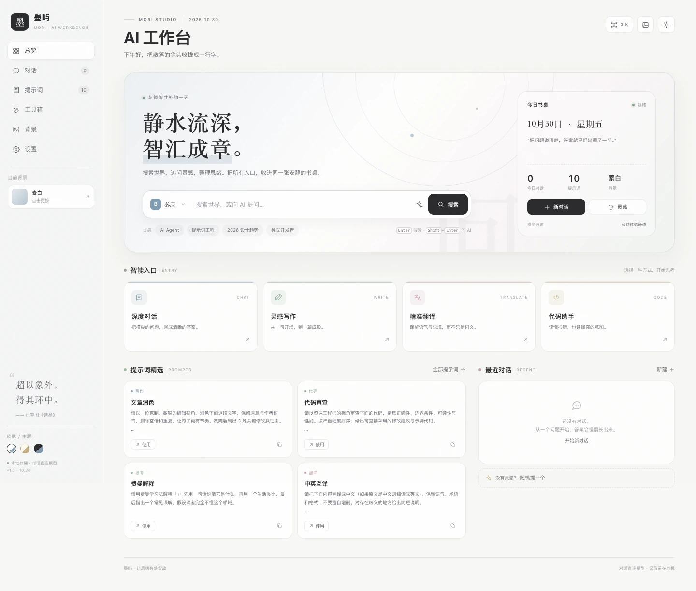
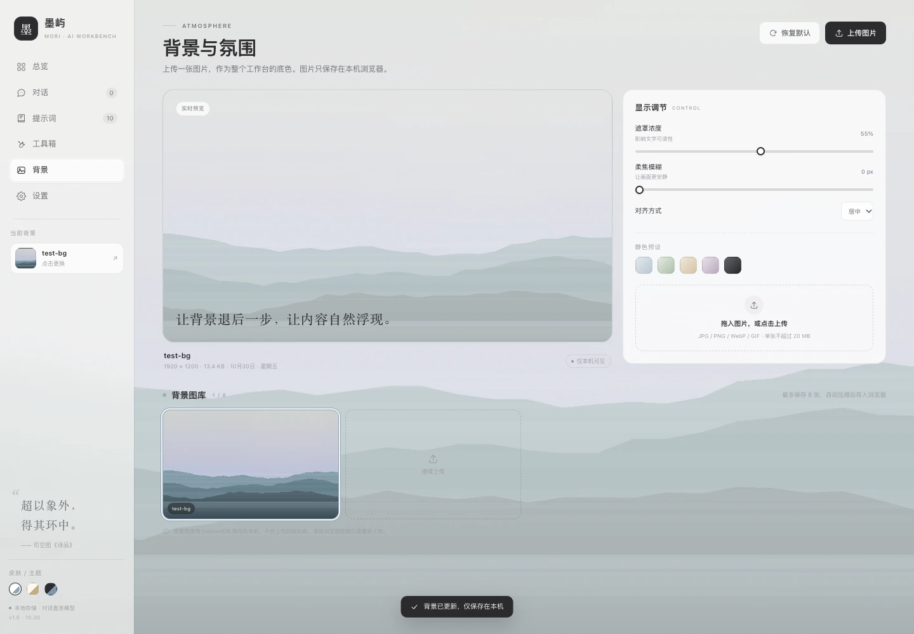
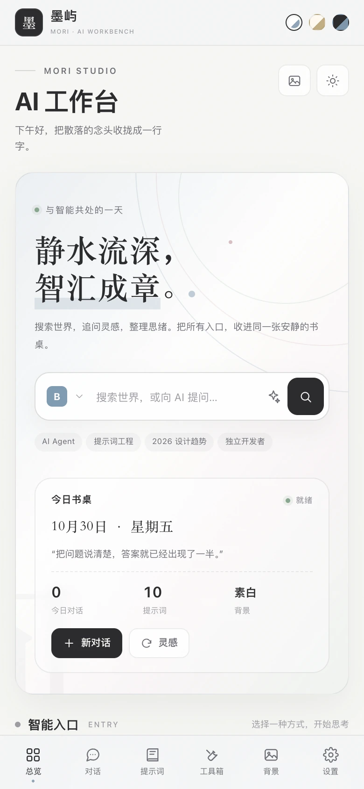
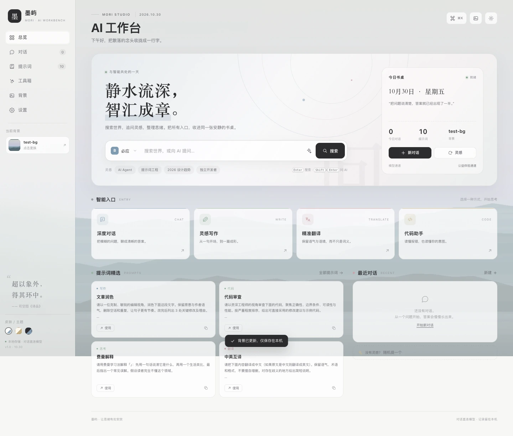

# 墨屿 · AI 工作台

> 静水流深，智汇成章。

一个安静、克制、无账号体系的个人 AI 工作台。把搜索、AI 对话、提示词、本地小工具与一张可自定义的桌面背景，收进同一张书桌。

页面视觉语言参考了 [Suzy'2027 的灵犀页面](https://publish.lingxispace.cn/webpages/edb7d521b1d716ba)，但所有代码与素材均为本项目原创实现。

**在线体验**：[https://nexn0.github.io/ai-workbench/](https://nexn0.github.io/ai-workbench/)



---

## 功能

### 搜索与入口
- 主页大搜索框，可在 **必应 / 百度 / Google / DuckDuckGo / GitHub** 之间切换，偏好自动保存。
- `Shift + Enter` 直接把问题交给 AI，或点击搜索框内的星芒按钮。
- 搜索记录只保留最近 6 条，可一键清除。

### AI 对话
- 内置 **公益体验通道**（Pollinations，无需 API Key，开箱即用）与 **自定义 OpenAI 兼容接口** 两种模型通道。
- 流式输出、停止生成、复制回答、Markdown 渲染（标题、列表、表格、代码块等）。
- 五种人格：通用助手、写作编辑、翻译专家、代码顾问、思考伙伴。
- 会话历史、自动标题、删除/清空，全部保存在本机。
- 自定义接口支持 API Key、模型名称、附加请求头与温度。

### 提示词库
- 10 条内置提示词，覆盖写作、效率、代码、翻译、思考。
- 支持新增、分类筛选、关键词搜索、复制与一键使用。
- 自定义提示词保存在本机。

### 本地工具箱
- 字数统计、JSON 格式化、Base64 编解码、时间戳转换、URL 编解码。
- 全部在浏览器内完成，输入内容不会离开设备。

### 背景与氛围
- 拖入或选择图片即可作为整站背景，自动压缩为 WebP（最长边 2560px），保存在 **IndexedDB**。
- 支持遮罩浓度、柔焦模糊、对齐方式实时调节；一个键盘/一个滑块即可找到舒适的可读性。
- 图库最多 8 张，可随时切换、删除或恢复默认。
- 5 组静色预设；无背景时保留一套带墨环的默认预览。

### 外观与交互
- 素白 / 宣纸 / 墨夜三套主题。
- 命令面板 `⌘K`（Windows/Linux 为 `Ctrl+K`），按 `/` 快速聚焦搜索。
- 响应式：桌面为侧边栏，移动端切换为顶部标题 + 底部导航。
- 支持减少动画、键盘操作与 `Esc` 关闭弹层。

## 预览

| 背景与氛围 | 移动端 |
| --- | --- |
|  |  |



## 本地运行

项目是纯静态站点，无需构建：

```bash
cd ai-workbench
python3 -m http.server 8080
# 打开 http://127.0.0.1:8080
```

也可以使用任意静态服务器（Node、Nginx 等）。脚本使用原生 ES Modules，请通过 HTTP 访问，而不是直接双击 `index.html`。

## 模型配置

打开 **设置 → 模型通道**：

- **公益体验通道**：默认选中，直接可用。由第三方 Pollinations 提供服务，质量和可用性取决于服务方，请勿用于敏感内容。
- **自定义接口**：填写完整的 chat completions 地址，例如 `https://api.openai.com/v1/chat/completions`（若填写 `.../v1`，会自动补全路径）、API Key 与模型名称。

> 所有模型请求都由浏览器直接发往你配置的接口。API Key 保存在当前浏览器的 `localStorage` 中，不会上传到本项目服务器；但这也意味着本页脚本可以读取它。请使用受限密钥，并只在可信设备上使用。
>
> 部分模型服务未开放浏览器跨域（CORS），直接调用会失败。此时需要通过允许跨域的服务，或自建代理。公益通道已允许跨域，因此可以直接体验。

## 数据与隐私

- 对话、提示词、搜索记录、主题与设置保存在 `localStorage`。
- 背景图片压缩后保存在 `IndexedDB`（数据库名 `mori-workbench`）。
- 对话内容会发送到你选择的模型服务；除此之外，本项目没有后端，也没有埋点或账号系统。
- **设置 → 本地数据** 支持导出 JSON（不含 API Key 与背景图片原文件）与一键清空全部数据。

## 目录结构

```
.
├── index.html
├── assets
│   ├── css/style.css
│   ├── js
│   │   ├── app.js          # 路由、搜索、提示词、设置、命令面板
│   │   ├── core.js         # 存储、Markdown、弹窗、Toast
│   │   ├── background.js   # 背景图片压缩、IndexedDB、渲染控制
│   │   ├── chat.js         # 流式对话、人格、会话持久化
│   │   └── tools.js        # 本地小工具
│   └── img/favicon.svg
├── docs/                   # README 预览图
├── .nojekyll               # GitHub Pages
└── README.md
```

## 部署到 GitHub Pages

仓库已配置为从 `main` 分支根目录发布。推送到 GitHub 后，在仓库 **Settings → Pages** 中选择 `Deploy from a branch`、`main` / `/ (root)` 即可；完整的线上地址会形如：

```
https://<你的用户名>.github.io/ai-workbench/
```

`.nojekyll` 已包含，避免 GitHub Pages 的 Jekyll 处理。所有资源使用相对路径，因此项目页子路径也能正常工作。

## 浏览器支持

面向现代浏览器（Chrome / Edge / Safari / Firefox 近两年版本）。使用了 ES Modules、IndexedDB、`backdrop-filter`、`dvh` 等单位；不支持时布局仍可用，但背景模糊等视觉细节会降级。

## License

[MIT](LICENSE) © 2026 NEXN0
